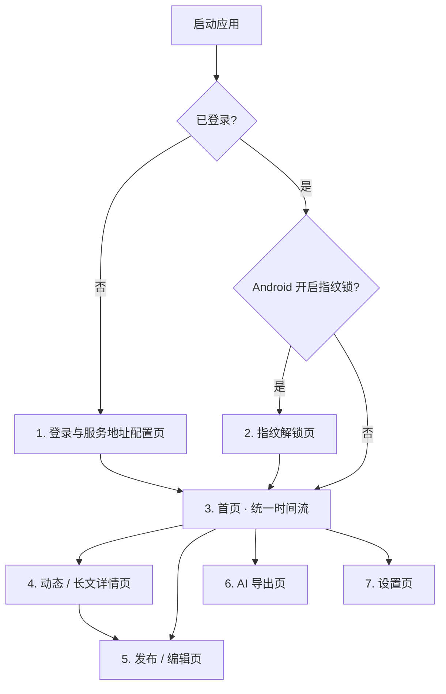

# 产品需求文档（PRD）— 素笺（Vellum）

> **产品名称**：素笺（Vellum）  
> **文档版本**：v2.0（极简定稿版）  
> **定位**：个人私有生活记录与 AI 状态分析软件（无社交、无标签、无情绪打分，回归纯粹记录）  
> **技术基线**：Java 17（Spring Boot 3 + Maven）+ PostgreSQL + MinIO + React（Web 端）+ Flutter（Android 端）

---

## 1. 产品目标

### 1.1 核心定位
打造一款**完全属于个人、私有部署、页面简洁耐看且极其流畅**的个人生活记录工具：
- 像朋友圈 / QQ 空间一样随手记录日常动态、心情文字、照片与所在城市；
- 支持长文写作以及 `.md`、`.txt` 文档上传入库与导出保存；
- 提供**时间段导出模式**：将一段时间的正文与关联照片打包导出为 Markdown 文档或含图 ZIP 包，方便直接交给 AI 分析前一段时间的个人状态。

### 1.2 核心原则
- **极致纯粹**：只做「记录、回顾、导出」，不引入标签体系、情绪打分、社交评论等无关功能。
- **隐私可控**：纯单人自用账号，HTTPS 加密传输 + 7 天 JWT 鉴权；Android 端支持本地指纹解锁；定位数据仅保存城市名（精确到市）。
-  mvn -f vellum-server/pom.xml test-compilebash

---

## 2. 目标用户与典型场景

- **目标用户**：开发者本人（单一用户，独享账号）。
- **典型场景**：
  1. **随手记录（Android）**：指纹解锁 → 写几句当下想法、选几张压缩照片、默认自动带出当前城市（失败则为空）→ 断网先存本地 SQLite，联网自动补发到服务器。
  2. **长文与文档整理（Web / Android）**：在线编写 Markdown 长文，或上传本地 `.md` / `.txt` 文档直接解析保存；任意记录均可另存为 `.md` / `.txt`。
  3. **统一时间流回看（双端）**：短动态像朋友圈直接展开正文与图片网格；长文或导入文档折叠展示标题与摘要，点击进入详情页阅读完整 Markdown 排版。
  4. **AI 阶段性复盘（Web / Android）**：选择起止时间（如最近 7 天 / 30 天 / 自定义区间），一键导出包含正文和图片的 `.md` 或 `.zip` 包，直接发给 AI 判断近阶段状态。

---

## 3. 功能清单（按优先级）

> - **P0（必须有 · 首版核心闭环）**
> - **P1（体验打磨 · 后续迭代）**

### 3.1 账号安全与基础能力

| 编号 | 功能 | 说明 | 优先级 | 适用端 |
| :--- | :--- | :--- | :---: | :---: |
| F-01 | 单账号登录与鉴权 | 用户名 + 密码登录，签发 **7 天有效期 JWT Token**；全链路支持 HTTPS 加密传输 | **P0** | 双端 |
| F-02 | 动态服务地址配置 | 登录页与设置页支持填写/切换后端地址（本地开发与公网服务器无缝切换） | **P0** | 双端 |
| F-03 | 指纹 / 生物识别解锁 | Android 端调用系统生物识别，支持在设置中开关与切后台超时自动锁屏 | **P0** | Android |
| F-04 | 修改密码 | 校验旧密码后更新登录密码 | **P1** | 双端 |

### 3.2 统一时间流与检索

| 编号 | 功能 | 说明 | 优先级 | 适用端 |
| :--- | :--- | :--- | :---: | :---: |
| F-05 | 统一时间流展示 | 按记录时间倒序分页展示；短动态直接展开正文 + 照片网格；长文/导入文档折叠为标题与摘要卡片 | **P0** | 双端 |
| F-06 | 照片自适应网格与看图画廊 | 自适应图片圆角网格，点击全屏查看（支持双指缩放、左右滑动） | **P0** | 双端 |
| F-07 | Markdown 详情阅读 | 详情页支持完整 Markdown 排版渲染 | **P0** | 双端 |
| F-08 | 基础筛选与搜索 | 支持关键词搜索、按类型（全部 / 动态 / 长文）、起止日期、城市筛选 | **P0** | 双端 |
| F-09 | Hero 过渡与微动效 | Android 端点击图片或卡片进入画廊/详情时的流畅共享元素过渡动画 | **P1** | Android |

### 3.3 内容记录、文档与定位

| 编号 | 功能 | 说明 | 优先级 | 适用端 |
| :--- | :--- | :--- | :---: | :---: |
| F-10 | 动态与长文发布 / 编辑 / 删除 | 支持随手动态与带标题的 Markdown 长文（Web 端支持分栏实时预览）；支持补记/调整记录时间 | **P0** | 双端 |
| F-11 | 城市级定位（仅存城市名） | 新建时**默认调用端侧定位接口自动获取并填充市名**（用户无需手动选择）；**获取失败时弹窗提示**，支持手动选择或留空置为空；数据库仅保存城市名 | **P0** | 双端 |
| F-12 | `.md` / `.txt` 上传与另存 | 支持上传 `.md` 或 `.txt` 文件读取正文直接入库；任意记录支持一键另存为 `.md` 或 `.txt` | **P0** | 双端 |
| F-13 | 照片压缩与 MinIO 存储 | 手机相册/拍照或网页选图后自动压缩（省空间、省流量），统一上传至 MinIO 存储 | **P0** | 双端 |
| F-14 | Android 离线缓存与自动补发 | 本地 SQLite 缓存历史列表；断网/弱网时新写记录与本地图片先存本地队列，恢复网络后自动调普通发布接口补发 | **P0** | Android |

### 3.4 AI 导出模式

| 编号 | 功能 | 说明 | 优先级 | 适用端 |
| :--- | :--- | :--- | :---: | :---: |
| F-15 | 按时间段导出 Markdown / ZIP | 选择起止时间（快捷近 7 天 / 30 天 / 自定义），将对应时间段内的正文按时间结构化整理为 `.md` 文档，并包含关联图片生成 `.md` 或 `.zip` 下载/分享 | **P0** | 双端 |
| F-16 | 深色 / 浅色主题切换 | 支持浅色、深色及跟随系统自动切换 | **P1** | 双端 |

---

## 4. 页面说明

| 序号 | 页面名称 | 适用端 | 核心元素与交互说明 |
| :-: | :--- | :--- | :--- |
| 1 | **登录与服务配置页** | 双端 | 账号、密码输入与登录按钮；可折叠配置后端服务器地址 |
| 2 | **指纹解锁页** | Android | 极简锁屏界面，自动拉起系统指纹验证，提供密码验证回退入口 |
| 3 | **首页 · 统一时间流** | 双端 | 顶部搜索框与轻量筛选（全部/动态/长文、日期、城市）；时间流卡片（日期 + 正文/长文摘要 + 图片网格 + 城市名）；悬浮快速发布入口 |
| 4 | **动态 / 长文详情页** | 双端 | 完整 Markdown 渲染正文、日期与城市信息、全屏缩放看图画廊；右上角提供编辑、导出为 `.md`/`.txt`、删除操作 |
| 5 | **发布 / 编辑页** | 双端 | 「动态 / 长文」模式切换（Web 端支持分栏预览）；相册选图与预览；**默认调用系统/浏览器定位自动填充城市，获取失败时弹窗提示（支持手动选择或留空）**；导入 `.md`/`.txt` 填充正文；Android 断网直接存本地等待联网自动补发 |
| 6 | **AI 导出页** | 双端 | 选择时间范围（近 7 天 / 30 天 / 自定义区间）→ 选择导出为 `.md` 或含图 `.zip` → 一键下载/分享给 AI 分析 |
| 7 | **设置页** | 双端 | 切换服务器地址、修改密码（P1）、外观主题（P1）、退出登录；Android 专属：指纹解锁开关、本地待补发记录查看与手动重试 |
